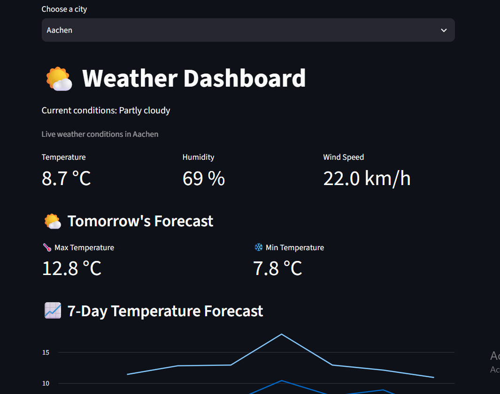

# 🌤️ Weather Dashboard

An interactive weather dashboard built with **Python, Streamlit, Pandas, and SQLite**.

The application retrieves live weather data from the Open-Meteo API, displays forecasts, and allows users to save and visualize historical weather measurements.

## Features

- 🌍 View live weather conditions for Aachen, Cologne, Berlin, and Munich
- 🌡️ Display temperature, humidity, and wind speed
- ☀️ Show dynamic weather icons based on current conditions
- 📅 View tomorrow's minimum and maximum temperatures
- 📈 Visualize a 7-day temperature forecast
- 💾 Save weather measurements in a SQLite database
- 📊 Explore historical temperature data
- 🎨 Modern dark-themed interface with blue accents
- 🛠️ Handle API connection errors

## Technologies Used

- **Python** — Application logic
- **Streamlit** — Interactive web interface
- **Requests** — REST API communication
- **Pandas** — Data processing
- **SQLite** — Local database
- **Open-Meteo API** — Weather data and forecasts

## Installation

### 1. Clone the repository

```bash
git clone https://github.com/semah-abid/weather-dashboard.git
cd weather-dashboard
```


### 2. Install dependencies

```bash
pip install -r requirements.txt
```

### 3. Run the application

```bash
python -m streamlit run app.py
```


## Screenshots



## What I Learned

Through this project, I practiced:

- Working with REST APIs and JSON responses
- Processing and visualizing data using Pandas
- Designing interactive interfaces with Streamlit
- Storing and retrieving information using SQL
- Organizing a Python project for GitHub
- Implementing basic error handling

## Future Improvements

- Search for additional cities
- Add hourly weather forecasts
- Deploy the dashboard online
